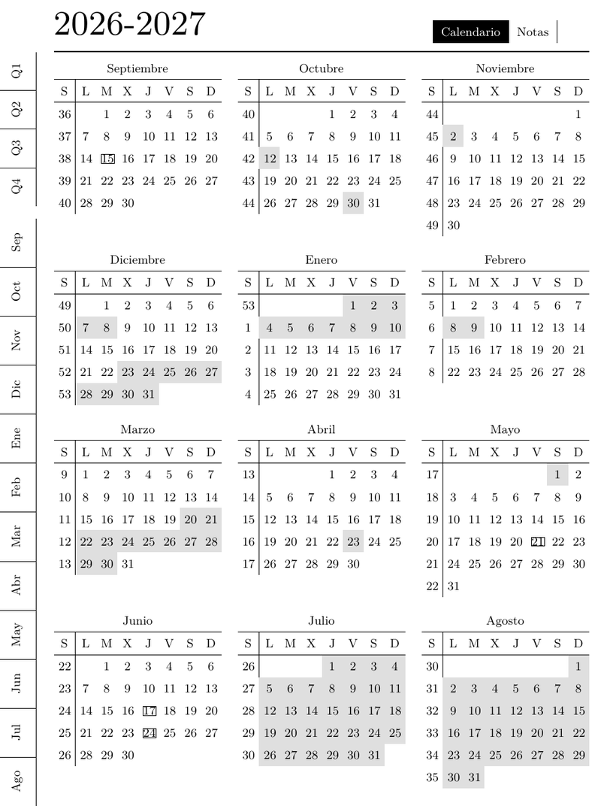
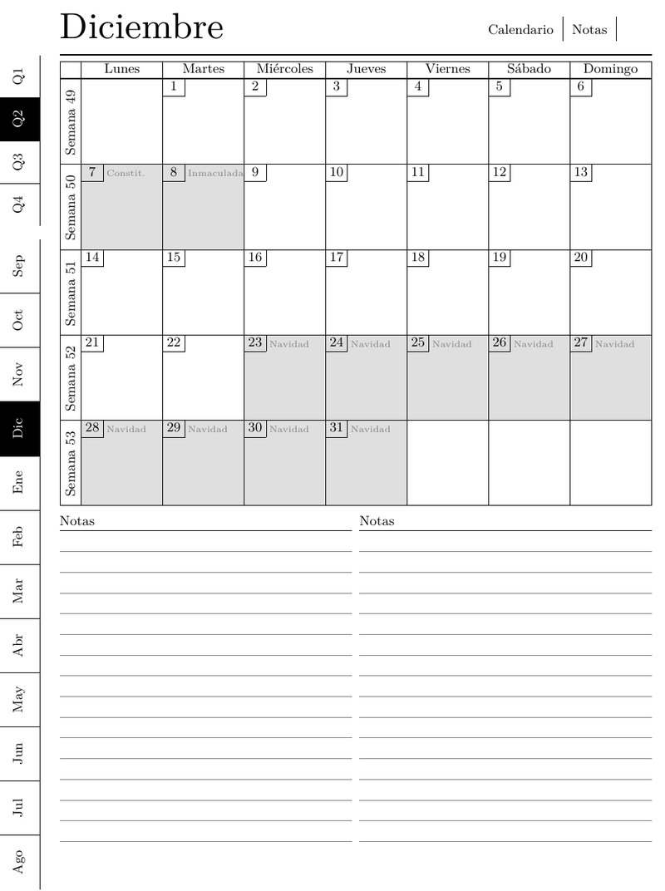
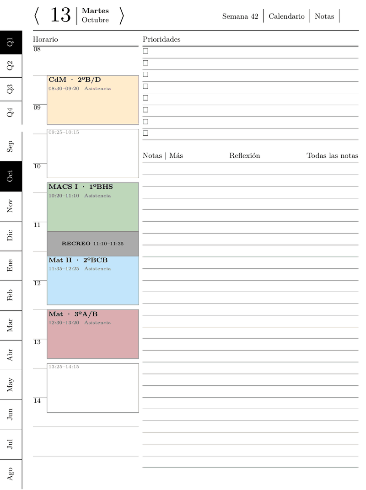
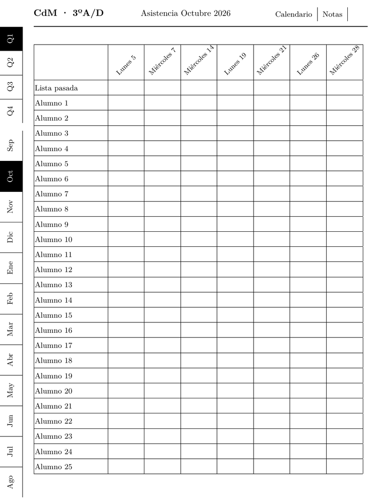

# latex-yearly-planner · Edición docente

> **English summary.** This is a fork of [kudrykv/latex-yearly-planner](https://github.com/kudrykv/latex-yearly-planner) adapted for secondary-school teachers in Spain. On top of the original hyperlinked e-ink planner it adds a September–August school year, the teacher's weekly timetable drawn on every daily page (one soft color per subject, still distinguishable in grayscale), the regional school calendar (holidays, vacations, key dates) marked on every view, and one attendance sheet per class group and month, linked both ways with the daily pages. Labels are in Spanish. The documentation below is in Spanish; the build works the same way as upstream (Go + XeLaTeX).

Planificador en PDF para tabletas de tinta electrónica (pensado para la **reMarkable 2**), adaptado al trabajo de un profesor de Secundaria y Bachillerato. Es un fork de [kudrykv/latex-yearly-planner](https://github.com/kudrykv/latex-yearly-planner): conserva todo lo que hace el original (vistas anual, trimestral, mensual, semanal y diaria, notas, todo enlazado con hipervínculos) y le añade lo que necesita un docente.

## Qué añade esta edición

**Curso escolar de septiembre a agosto.** El planificador empieza en septiembre y la portada dice «Curso 2026-2027». Se generan 12 meses para que los cuatro trimestres del diseño queden iguales; julio y agosto salen como vacaciones.

**Horario de clases en cada página diaria.** La columna de horario muestra la jornada real del centro: cada periodo lectivo es una caja, las clases aparecen rellenas con el nombre del grupo y la hora, y el recreo va marcado aparte. Los periodos sin clase quedan como cajas vacías (horas de permanencia). Cada materia tiene su propio color suave; los colores están elegidos para que en la reMarkable, que los muestra en gris, sigan viéndose distintos. Un grupo puede terminar antes que el resto (por ejemplo 2º de Bachillerato en mayo) y a partir de esa fecha deja de aparecer.

**Calendario escolar.** Los festivos y vacaciones del calendario autonómico se sombrean en todas las vistas y su nombre aparece en la página del día, que ese día no muestra clases. Las fechas señaladas (inicio y fin de curso, pruebas extraordinarias…) se marcan sin quitar las clases. Se incluye el calendario 2026-2027 de Castilla y León como ejemplo.

**Hojas de asistencia.** Una página por grupo y por mes, con una columna por cada día que ese grupo tiene clase (solo los días reales, ya descontados festivos y vacaciones), una fila «Lista pasada» para marcar que se pasó lista y una fila por alumno. Desde cada clase de la página diaria, el enlace «Asistencia» lleva a la hoja de ese grupo y mes; desde la cabecera de cada columna de la hoja se vuelve a la página de ese día.

**En español.** Meses, días y rótulos traducidos con `translations/spanish.json`.

## Capturas

 

 

De izquierda a derecha y de arriba abajo: vista anual del curso, mes de diciembre, un martes con cuatro clases y el recreo, y la hoja de asistencia de octubre de un grupo. Las capturas son de la versión a color (la que se ve en el móvil o el ordenador); en la reMarkable 2 se ven en escala de grises.

## Cómo generar tu planificador

### Requisitos

Hace falta lo mismo que en el proyecto original: [Go](https://go.dev/dl/), una distribución de LaTeX con **XeLaTeX** (en Debian/Ubuntu, los paquetes `texlive-xetex` y `texlive-latex-extra`), Python 3 (para la traducción) y una terminal con `bash`. Está probado en Linux.

### Pasos

1. Descarga el código, en la rama `teacher-edition`:

   ```bash
   git clone -b teacher-edition https://github.com/javoxmg/latex-yearly-planner.git
   cd latex-yearly-planner
   ```

2. Adapta los archivos de configuración de la carpeta `cfg/` (ver la tabla de abajo). Todos llevan comentarios en español que explican cada campo.

3. Genera el planificador indicando el año en que empieza el curso:

   ```bash
   ./build_teacher_planner.sh 2026     # curso 2026-2027
   ```

   Tarda alrededor de un minuto y deja `teacher_planner_2026-27.pdf` en la carpeta del proyecto. Cópialo a la tableta como cualquier otro PDF.

### Qué editar

| Archivo | Para qué sirve |
|---|---|
| `cfg/teacher_schedule.yaml` | Tu horario: periodos de la jornada, recreo, clases de cada día con su grupo, fecha de fin de los grupos que acaban antes y colores por materia. |
| `cfg/teacher_calendar_2026-27.yaml` | El calendario escolar del curso: inicio y fin de las clases, festivos, vacaciones y fechas señaladas. Para otro curso o comunidad, cópialo con el nombre del curso (`teacher_calendar_2027-28.yaml`) y cambia las fechas. Los dos festivos locales de tu municipio hay que añadirlos a mano. |
| `cfg/teacher_students.yaml` | Las listas de alumnos de cada grupo, para las hojas de asistencia. **No viene en el repositorio**: se crea copiando el ejemplo (ver abajo). |
| `cfg/teacher_base.yaml` | Preferencias generales: semana que empieza en lunes, formato de 24 horas, líneas en lugar de puntos. |

### Listas de alumnos (datos privados)

Los nombres de los alumnos son datos personales de menores, así que el archivo real nunca se sube a GitHub: `cfg/teacher_students.yaml` está en `.gitignore`. Para crearlo, copia el ejemplo y sustituye los «Alumno N» por los nombres:

```bash
cp cfg/teacher_students.example.yaml cfg/teacher_students.yaml
```

El nombre de cada grupo tiene que coincidir exactamente con el `group` de `teacher_schedule.yaml`. Si el archivo no existe, las hojas de asistencia salen igualmente, con filas en blanco para rellenar a mano.

### Otros dispositivos

El script genera la versión para reMarkable 2. Como en el proyecto original, la configuración es una cadena de archivos YAML en la que el último gana; la cadena está al final de `build_teacher_planner.sh`. Para otro dispositivo se cambian los archivos `rm2.*` por los del dispositivo que corresponda dentro de `cfg/` (por ejemplo los de reMarkable con firmware DDVK). Las piezas docentes (`teacher_*.yaml`) van siempre al final.

## Proyecto original y licencia

Todo el diseño base, el generador y las vistas originales son obra de [Vitaliy Kudryk](https://github.com/kudrykv) en [kudrykv/latex-yearly-planner](https://github.com/kudrykv/latex-yearly-planner), donde están la documentación original, las [discusiones](https://github.com/kudrykv/latex-yearly-planner/discussions) y planificadores ya generados para muchos dispositivos. Esta edición mantiene su licencia [MIT](LICENSE).
